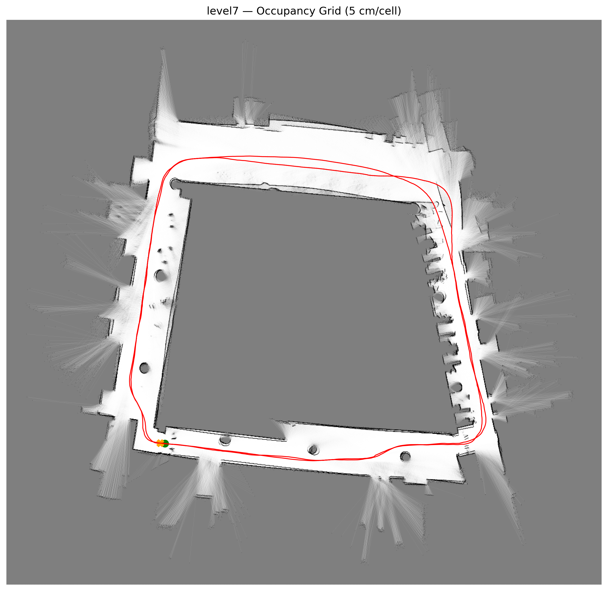
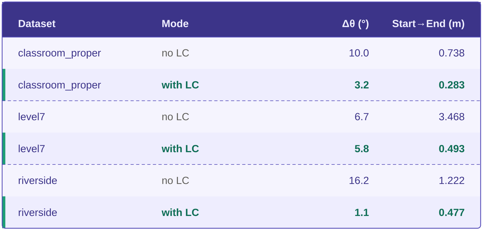
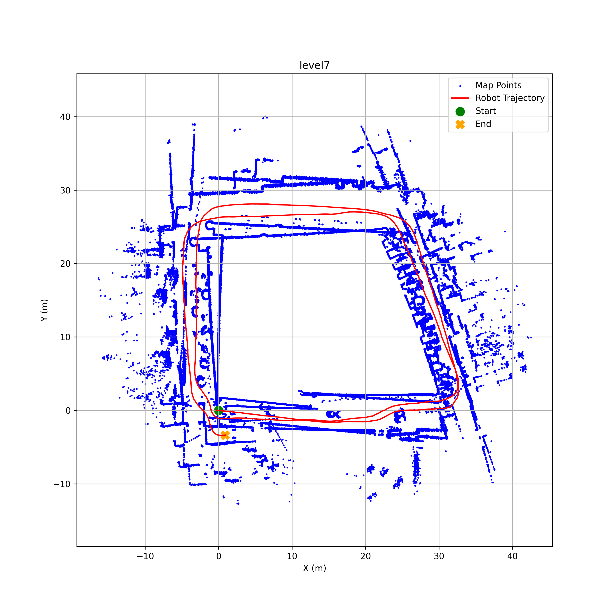
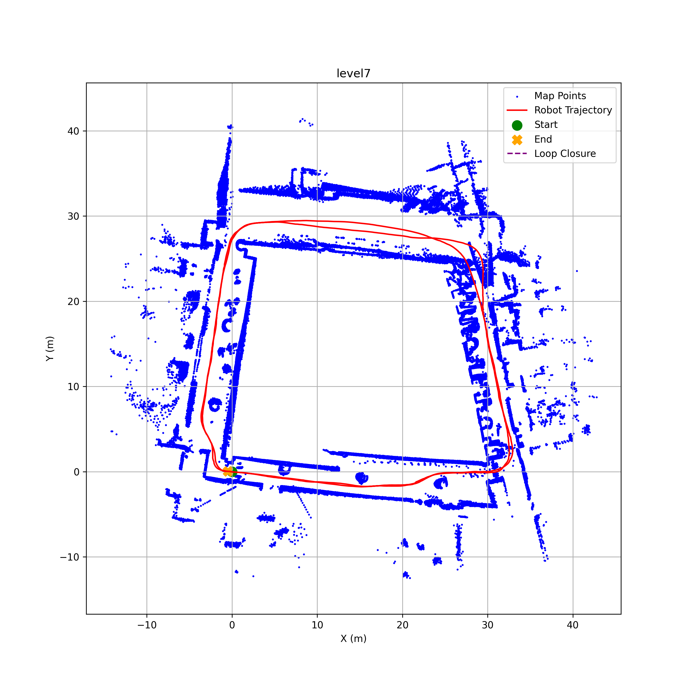
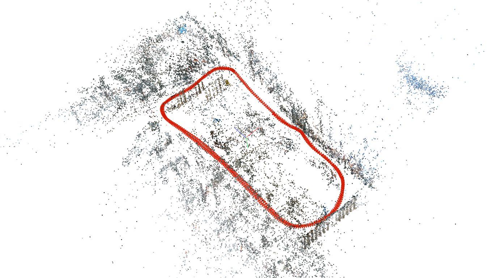
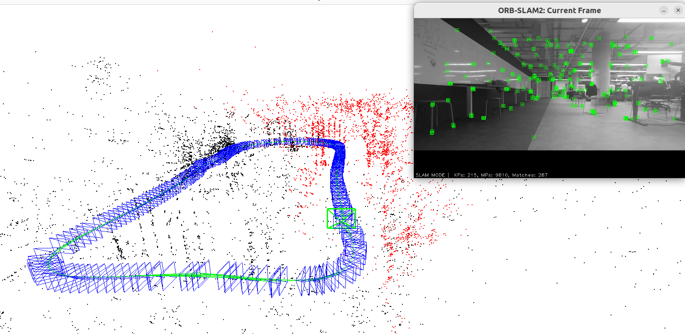
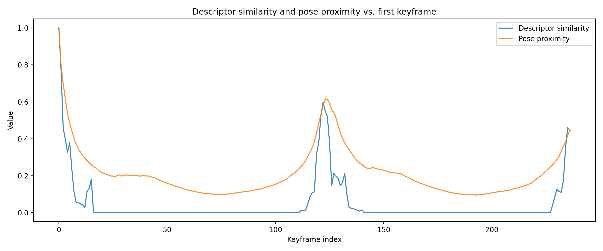

# Visual and LiDAR SLAM

This repository contains a group project on simultaneous localisation and mapping (SLAM) with a camera and with a 2D LiDAR, in three parts:

* **ORB-SLAM2 on public data**: monocular ORB-SLAM2 on KITTI and TUM RGB-D, with ablations on the number of ORB features, outlier rejection and loop closure;
* **visual SLAM on our own data**: indoor and outdoor sequences recorded with a RealSense camera at UCL, reconstructed with COLMAP and with ORB-SLAM2 and compared by pose error;
* **LiDAR SLAM**: ICP scan-to-map odometry, a parameter sweep on the LiDAR scans, automatic loop-closure detection and factor-graph optimisation with GTSAM, on LiDAR datasets recorded around UCL Marshgate.

The full write-up is in [report.pdf](./report.pdf), and the presentation is in [slides.pptx](./slides.pptx) and [presentation.mp4](./presentation.mp4). Developed as a group project for Coursework 2 of the UCL module *COMP0249: Robot Vision and Navigation* (2026).



## Repository structure

| Part | Code |
|---|---|
| Visual SLAM, own data — frame selection and masking | `code/Q2/extract_dataset_timestamp.py` |
| Visual SLAM, own data — ORB-SLAM2 camera settings from COLMAP | `code/Q2/camera_calibration_bartlett.yaml`, `code/Q2/camera_calibration_riverside.yaml` |
| LiDAR SLAM — odometry, loop detection, factor graph, maps and videos | `code/Q3/icp_full.py` |
| LiDAR SLAM — results with and without loop closure | `code/Q3/runner.py` |
| LiDAR SLAM — beam quality per dataset | `code/Q3/quality.py` |
| LiDAR SLAM — loop-detection signals | `code/Q3/exploration.py`, `code/Q3/exploration_simple.py` |

* `code/Q3/pickles` — the keyframes saved by each SLAM run;
* `code/Q3/pictures`, `code/Q3/slam_results` — point maps and occupancy grids, with and without loop closure;
* `code/Q3/videos` — the maps being built live, with loop-closure corrections;
* [figures](./figures/) — figures from the report and the slides;
* [report.pdf](./report.pdf), [slides.pptx](./slides.pptx), [presentation.mp4](./presentation.mp4) — the report and the presentation.

The ORB-SLAM2 runs on KITTI and TUM used ORB-SLAM2 and evo as they are, so that part has no code here.

## Built on

* [ORB-SLAM2](https://github.com/raulmur/ORB_SLAM2) — monocular visual SLAM;
* [COLMAP](https://colmap.github.io/) — structure from motion and camera calibration;
* [evo](https://github.com/MichaelGrupp/evo) — trajectory alignment and the absolute and relative pose errors;
* [GTSAM](https://gtsam.org/) — the factor graph of the LiDAR SLAM;
* [KITTI](https://www.cvlibs.net/datasets/kitti/) odometry and [TUM RGB-D](https://cvg.cit.tum.de/data/datasets/rgbd-dataset) — the public datasets;
* [NumPy](https://numpy.org/), [scikit-learn](https://scikit-learn.org/), [OpenCV](https://opencv.org/) and [Matplotlib](https://matplotlib.org/).

## Method

**ORB-SLAM2 on public data.** ORB-SLAM2 runs monocular on KITTI odometry sequence 07, a car in a residential area at 10 fps, and on a TUM fr3 sequence around an office desk at 30 fps. Each run is scored against ground truth by absolute trajectory error (ATE). The ablations reduce the ORB features from 2000 to 1250 on KITTI and from 1000 to 700 on TUM, then turn off outlier rejection, then turn off loop closure.

**Visual SLAM on our own data.** A RealSense camera fixed to a chair recorded an indoor loop in the Bartlett studio at UCL Marshgate and an outdoor loop on the Riverside patio, at 848 × 480 and 10 fps. Each sequence was cut to whole loops and downsampled to 550 images, and the bottom 14% of the indoor images was masked to hide the chair. COLMAP calibrated the camera with an 8-parameter OpenCV model and built a dense reconstruction. Its intrinsics went into ORB-SLAM2, with 1000 features indoors and 2000 outdoors. The COLMAP trajectory is the reference, and the two are compared by absolute and relative pose error after a Sim(3) Umeyama alignment.

**LiDAR SLAM.** Each scan is aligned to a local map by ICP to give the odometry.

* Four parameters were varied one at a time on three datasets, the classroom, the Level 7 foyer and the Riverside café: the maximum range, the angular resolution, a voxel grid filter and the scan rate. Each run is scored by how well its two loops overlap and by its start-to-end error.
* Loop closures are detected by aggregating each keyframe with its ±10 neighbours and computing a 36 × 24 bearing–range histogram, compared by cosine similarity. A closure needs a peak in both descriptor similarity and pose proximity, confirmed over a 5-keyframe window, at least 30 keyframes apart and within 3 m. At most 10 closures are added.
* GTSAM holds one pose node per keyframe, odometry factors from ICP and loop-closure factors that tie two poses together. A Levenberg–Marquardt optimisation runs on every closure, and the map is redrawn from the corrected poses.

## Results

| ATE RMSE | KITTI 07 | TUM fr3 |
|---|---|---|
| Baseline | 3.028 m | 0.025 m |
| Fewer ORB features | 12.350 m at 1250 | 0.018 m at 700 |
| No outlier rejection | 6.959 m, 510 of 1101 frames tracked | 0.930 m, 1433 of 2555 frames tracked |
| No loop closure | 2.346 m, 388 of 1101 frames tracked | 0.653 m, 1116 of 2555 frames tracked |

| Own data, ORB-SLAM2 against COLMAP | Bartlett, indoor | Riverside, outdoor |
|---|---|---|
| Absolute pose error, RMSE | 0.034 m | 0.067 m |
| Relative pose error, RMSE | 0.016 m | 0.033 m |

* **ORB-SLAM2 on public data.** KITTI needs many features: at 1250 it struggles to initialise, and at 750 it fails outright. TUM tracks slightly better with fewer features, as the extractor keeps only the strongest corners. Without outlier rejection or loop closure, neither sequence is tracked to the end. The lower KITTI error without loop closure only covers the easy first 388 frames.
* **Own data.** ORB-SLAM2's map is much sparser than COLMAP's, but both close the loop, and its path is accurate to a few centimetres. The largest errors are at fast turns on the spot, where monocular SLAM has too little translation to triangulate.
* **LiDAR parameters.** Fewer scans never made things worse, and nearly halved the loop separation on Level 7, from 0.72 m to 0.44 m, since fewer ICP steps add less drift. A voxel grid gave the best classroom and Riverside results. A 6 m range limit helped only in the small classroom, and fewer beams hurt Level 7 most.
* **Loop closure.** Loop closure cut the start-to-end error on all three datasets. Two datasets failed even so: the Bartlett art room, with reflective windows and few close objects, and an outdoor car park.



| | |
|---|---|
|  |  |
|  |  |



## Running

```
pip install -r requirements.txt
```

The LiDAR scripts read the course's LiDAR recordings, `<name>_LiDAR.json`, from `dataset/lidar` next to `icp_full.py`. The recordings and camera images are not included in this repository.

* `python icp_full.py` runs the SLAM on each dataset, saves the maps, occupancy grids and videos, and writes `<name>_keyframes.pkl`. The videos need ffmpeg.
* `python runner.py` runs each dataset with and without loop closure and prints the results table.
* `quality.py` and the exploration scripts read the `<name>_keyframes.pkl` files from the folder they are run in. The saved ones are in `code/Q3/pickles`.

## Authors

Hashim Al-Obaidi, Amir Gerges, Manuel Jardim and Cristhian Poveda, MSc Robotics and Artificial Intelligence, UCL.
